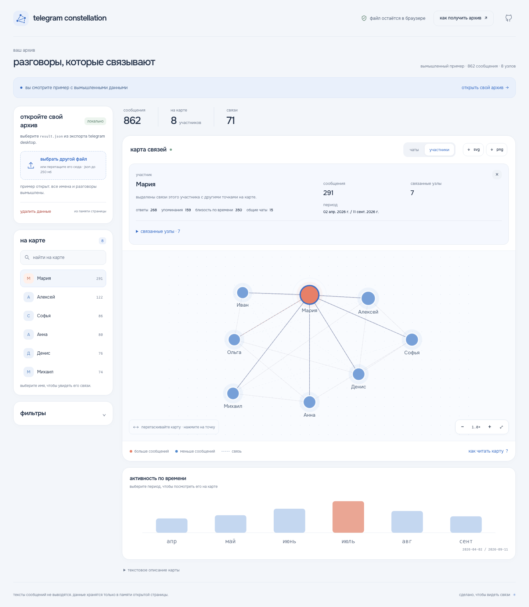
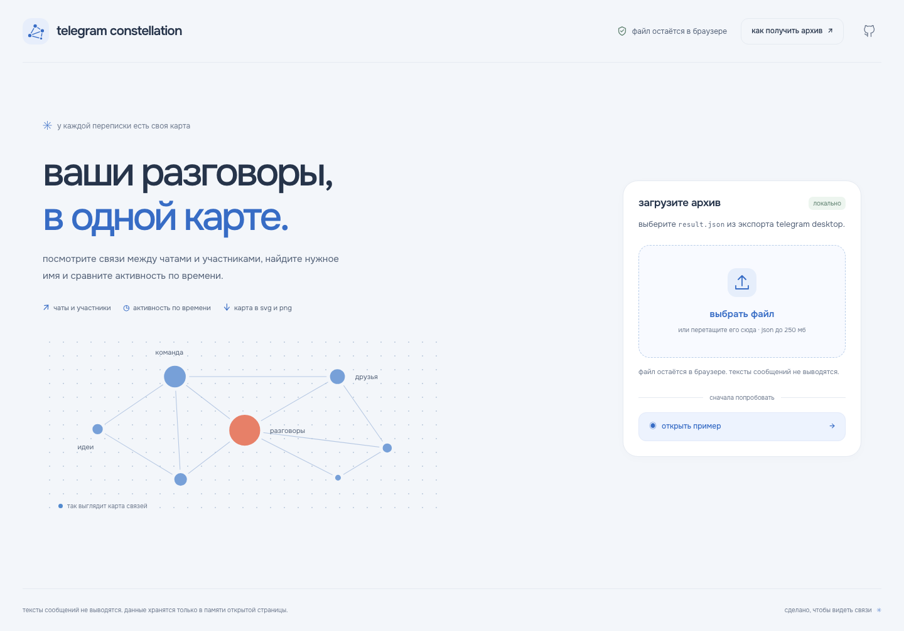
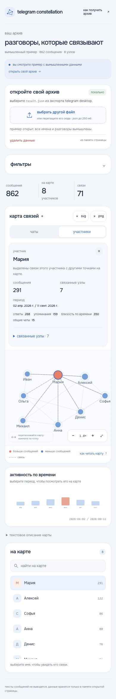

# telegram constellation

карта чатов, участников и активности из локального экспорта telegram. найдите нужное имя, посмотрите связи и сравните периоды. файл остаётся в браузере.

[открыть карту ↗](https://chebaturkin.github.io/telegram-constellation/)



## как пользоваться

1. откройте вымышленный пример или выберите `result.json`. файл также можно перетащить в область загрузки.
2. переключайтесь между чатами и участниками. размер точки показывает число сообщений, коралловый цвет выделяет высокую активность.
3. нажмите на точку или найдите имя в списке. над картой появятся детали, а связанные точки останутся выделенными. список связанных узлов позволяет перейти к соседнему участнику или чату.
4. раскройте фильтры для выбора чата, участника, дат или типов связей. можно оставить ответы и упоминания, убрав общие чаты и близость по времени. на шкале можно выбрать месяц; повторный выбор снимает период.
5. скачайте текущую карту в svg или png. «удалить данные» очищает страницу и возвращает первый экран.

«как получить архив» объясняет экспорт из telegram desktop. «как читать карту» открывает легенду и подсказки по клавиатуре.

<details>
<summary>первый экран и карта на телефоне</summary>

первый экран предлагает загрузить файл, открыть пример или прочитать инструкцию. все имена и разговоры в примере вымышлены.



на телефоне карта, фильтры и детали располагаются в одну колонку. подписи и области нажатия адаптируются к экрану.



</details>

## данные и приватность

- файл читается через браузерный file api и не отправляется на сервер;
- импорт работает без telegram api, аккаунта, аналитики и внешних моделей;
- тексты сообщений не сохраняются в модели, адресе страницы, логах и скачанной карте;
- после разбора остаются имена, даты, счётчики, идентификаторы и типы связей. скачанная карта содержит имена видимых узлов;
- данные хранятся только в памяти открытой страницы. перезагрузка или удаление данных очищает карту;
- ошибка нового импорта и отмена сохраняют уже открытую карту;
- шрифты и вымышленный пример находятся в репозитории. сторонние ресурсы при работе карты не загружаются.

## поддержка и ограничения

поддерживаются экспорт с несколькими чатами в `{ "chats": { "list": [...] } }`, один объект чата с `messages` и массив сообщений с полями отправителя, дат, ответов и упоминаний.

карта строит связи по ответам, упоминаниям, общим чатам для участников, общим участникам для чатов и близости по времени. несколько типов связи могут соединять одну пару точек. общие чаты, участники и близость по времени дают косвенные признаки связи; они не подтверждают прямой разговор.

в режиме «авто» смешанный экспорт открывает чаты, а один чат открывает участников. переключатель позволяет изменить слой. шкала показывает месяцы для выбранного чата или участника и сохраняет контекст при выборе дат.

файл читается целиком в браузере, предел составляет **250 мб**. zip-архив сначала нужно распаковать локально и выбрать `result.json`. пустые и повреждённые записи пропускаются. сообщения без корректной даты учитываются в общем количестве, но не попадают на шкалу; выбор периода исключает их из карты. если подходящих сообщений не осталось, интерфейс объясняет ошибку и сохраняет предыдущую карту.

выбор точки отмечается контуром, а импульс проходит к её соседям. фильтры сохраняют места знакомых точек. при системной настройке уменьшения движения анимации отключаются; выбор остаётся понятным по контуру и тексту. svg и png содержат конечное состояние без временной графики.

## запустить локально

из корня проекта, без сборки и установки зависимостей:

```bash
python3 -m http.server 4175
```

откройте [локальную карту](http://127.0.0.1:4175/). сервер раздаёт статические файлы; обработка архива происходит в браузере.

## проверки и снимки

```bash
node --test scripts/data-tests.mjs scripts/graph-tests.mjs
node scripts/design-copy-check.mjs
APP_PORT=4175 python3 scripts/smoke_test.py
APP_PORT=4175 python3 scripts/interaction_test.py
APP_PORT=4175 python3 scripts/redesign_test.py
APP_PORT=4175 python3 scripts/selection_test.py
APP_PORT=4175 python3 scripts/exploration_test.py
APP_PORT=4175 python3 scripts/motion_test.py
```

браузерные проверки и скриншоты используют python playwright и chromium:

```bash
python3 -m pip install playwright
python3 -m playwright install chromium
APP_PORT=4175 python3 scripts/capture_screenshots.py
```

сценарии проверяют импорт, ошибки, пример, поиск, выбор узла, слои, даты, экспорт, очистку, отсутствие сторонних запросов, клавиатуру и ширины 320, 375, 768 и 1440 px. скриншоты в `docs/screenshots/` сняты с работающего приложения в chromium на вымышленных данных.

## устройство

`app-data.js` отвечает за разбор экспорта, нормализацию, связи и фильтрацию. `import-worker.js` обрабатывает импорт в отдельном потоке. `demo-data.js` создаёт вымышленный пример локально. `app-motion.js` управляет анимациями, `app-graph.js` и `app-exploration.js` формируют список связанных узлов и пояснения об импорте.

дополнительные материалы: [визуальные правила](docs/DESIGN-RULES.md), [проверки](docs/QA-CHECKLIST.md), [источники и лицензии шрифтов](assets/fonts/SOURCES.md), [исследование аналогов](docs/2026-10-14-research-and-improvements.md).
