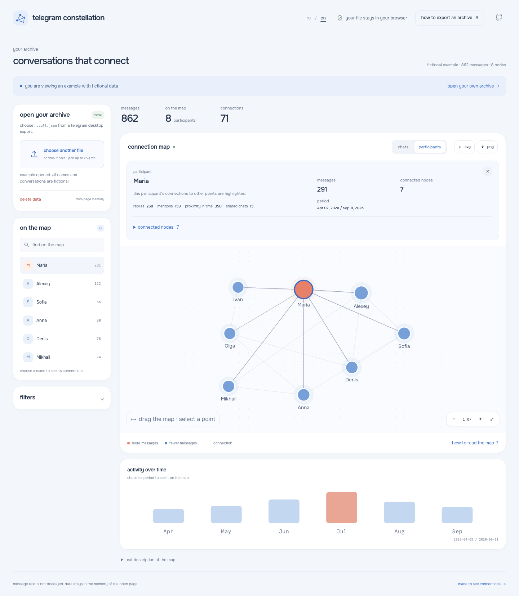
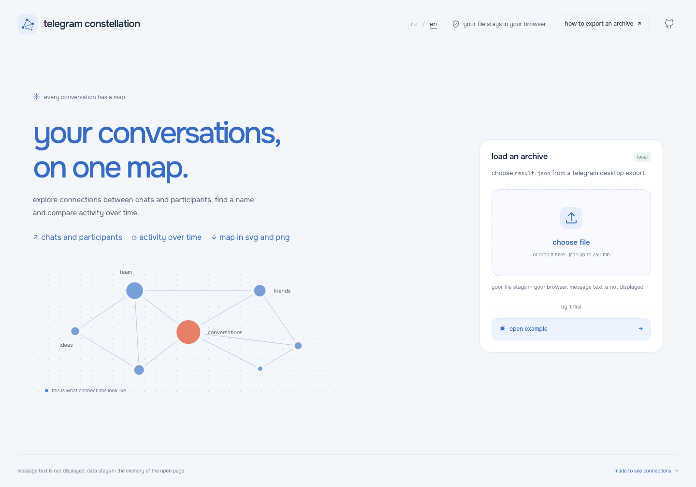
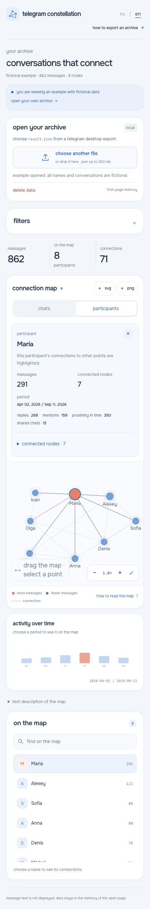

**english** · [русский](README.ru.md)

# telegram constellation

explore chats, participants and activity in a local telegram export. find a name, follow its connections and compare periods on the map. open the fictional example to see how it works, or choose your own `result.json`. your file stays in the browser.

[open in english ↗](https://chebaturkin.github.io/telegram-constellation/?lang=en) · [open in russian](https://chebaturkin.github.io/telegram-constellation/?lang=ru)



## using the map

1. open the fictional example or choose `result.json`. you can also drop the file into the upload area.
2. switch between chats and participants. point size represents message count; coral marks high activity.
3. select a point or find a name in the list. its details appear above the map and its connections stay highlighted. the connected-node list lets you move to a neighbouring chat or participant.
4. expand the filters to choose a chat, participant, dates or connection types. keep replies and mentions while hiding shared chats and proximity in time. choose a month on the timeline; choose it again to clear the period.
5. download the current map as svg or png. “delete data” clears the page and returns to the welcome screen.

“how to export an archive” explains the telegram desktop export. “how to read the map” opens the legend and keyboard instructions.

choose **ru / en** in the header to switch without reloading. the map, filters and search remain in place. a valid `?lang=ru` or `?lang=en` takes priority, followed by the saved choice, the first supported browser language and english. names from your own export stay untouched.

<details>
<summary>welcome screen and the map on a phone</summary>

the welcome screen offers a file upload, an example and export instructions. every name and conversation in the example is fictional.



on a phone, the map, filters and details form one column. labels and tap areas adapt to the screen.



</details>

## data and privacy

- the browser file api reads the file locally; it is not uploaded;
- import needs no telegram api, account, analytics or external model;
- message text is excluded from the model, page address, logs and downloaded map;
- parsing retains names, dates, counts, ids and connection types. downloaded maps include visible node names;
- data stays in the memory of the open page. reloading or deleting data clears the map;
- a failed or cancelled import keeps the map already open;
- fonts and the fictional example are included in the repository. the map loads no third-party resources.

## support and limits

supported inputs include a multi-chat export in `{ "chats": { "list": [...] } }`, one chat object with `messages`, or an array of messages with sender, date, reply and mention fields.

connections come from replies, mentions, shared chats between participants, shared participants between chats and proximity in time. several connection types can join the same pair. shared chats, participants and proximity provide indirect signs of a connection; they do not confirm a direct conversation.

“auto” opens chats for a mixed export and participants for a single chat. the mode control changes the layer. the timeline shows months for the selected chat or participant and retains that context while dates change.

the whole file is read in the browser, with a **250 mb** limit. unpack zip files locally first and choose `result.json`. empty and damaged records are skipped. messages without a valid date count toward the total but do not appear on the timeline; choosing a period excludes them from the map. if no usable messages remain, the app explains the error and keeps the previous map.

selection has an outline and sends a pulse toward neighbours. filters retain familiar point positions. reduced motion disables animations while the outline and text keep selection clear. svg and png contain the final state without temporary effects.

## run locally

from the project root, with no build or dependency installation:

```bash
python3 -m http.server 4175
```

open the local map in [english](http://127.0.0.1:4175/?lang=en) or [russian](http://127.0.0.1:4175/?lang=ru). the server serves static files; the browser processes the archive.

## checks and captures

node.js runs the data, graph, language and interface-copy checks:

```bash
node --test scripts/data-tests.mjs scripts/graph-tests.mjs scripts/i18n.test.mjs
node scripts/design-copy-check.mjs
```

browser checks use python playwright and chromium. keep the local server running:

```bash
python3 -m pip install playwright
python3 -m playwright install chromium
APP_PORT=4175 python3 scripts/smoke_test.py
APP_PORT=4175 python3 scripts/interaction_test.py
APP_PORT=4175 python3 scripts/redesign_test.py
APP_PORT=4175 python3 scripts/selection_test.py
APP_PORT=4175 python3 scripts/exploration_test.py
APP_PORT=4175 python3 scripts/motion_test.py
APP_URL=http://127.0.0.1:4175/ python3 scripts/verify-i18n.py
APP_URL=http://127.0.0.1:4175/ python3 scripts/verify-export-snapshot.py
```

checks cover import, errors, the example, search, selection, layers, dates, export, clearing, external requests, keyboard input, language defaults and switching, and 320 to 1440 px layouts. the export regression confirms that changing language during png decoding cancels the obsolete download and allows a new one in the selected language.

refresh the welcome screen, selected map and mobile map in both languages:

```bash
APP_URL=http://127.0.0.1:4175/ python3 scripts/capture-bilingual.py
```

russian captures are in `docs/screenshots/`; english captures are in `docs/screenshots/en/`. both use the running app and fictional data, with names translated for each language.

## source

`app-data.js` parses, normalizes, connects and filters exports. `import-worker.js` processes imports in a worker. `demo-data.js` creates the fictional example locally. `app-motion.js` controls animation; `app-graph.js` and `app-exploration.js` build connected-node lists and import explanations. `i18n.js` contains local dictionaries and locale selection.

the [visual guide](docs/DESIGN-RULES.md) describes the interface conventions; [font sources and licences](assets/fonts/SOURCES.md) are kept with the fonts. github pages publishes `main` through the [workflow](.github/workflows/pages.yml).
